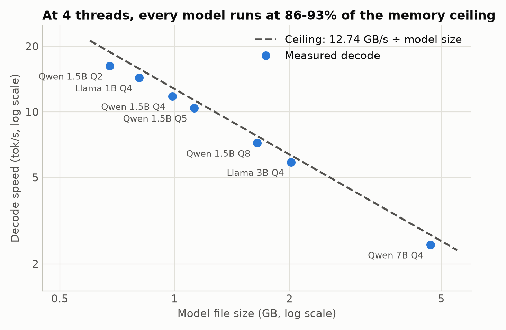
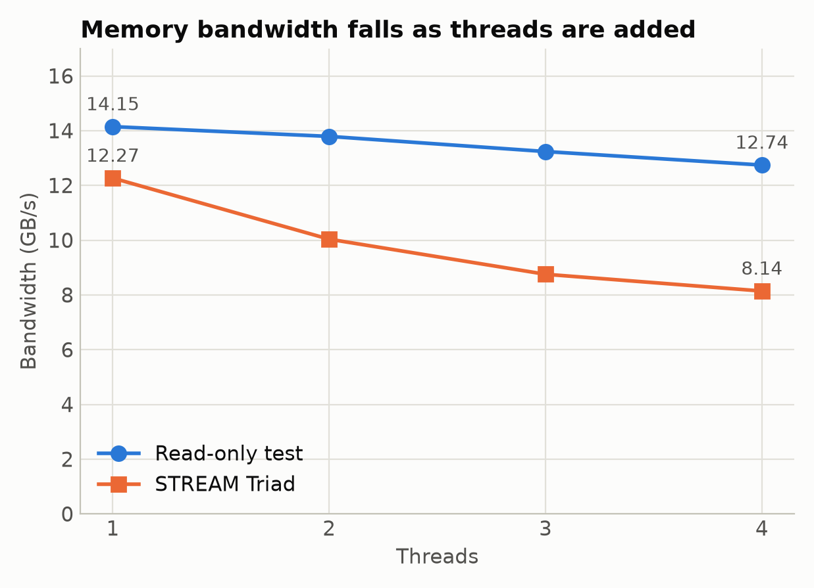
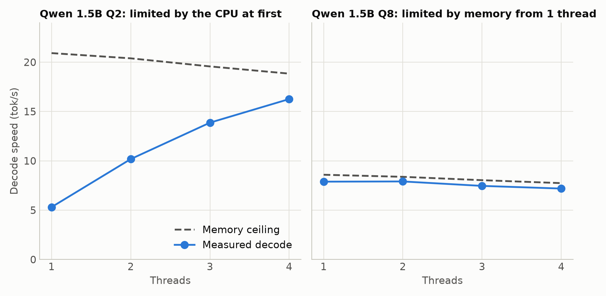
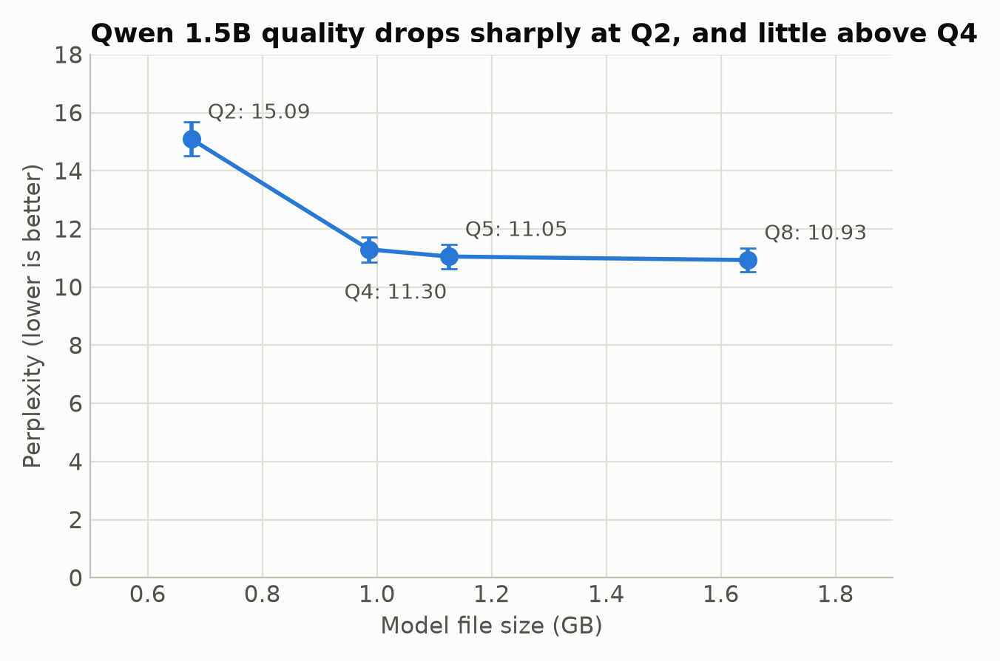

# LLM Inference Characterization on Raspberry Pi 5

**Is LLM decode on edge hardware limited by memory bandwidth?** I predicted decode speed from measured bandwidth and model size, compared the prediction with real runs on a Raspberry Pi 5, and explained the gap.

**Result:** at 4 threads, all 7 models ran at 86-93% of the predicted ceiling, across file sizes from 0.68 GB to 4.68 GB. None of the 25 configs exceeded it. With fewer threads, some models are limited by the CPU instead, so decode has two limits rather than one.



## The prediction

Generating one token reads about every model weight once, so:

```text
ceiling tok/s = read bandwidth / model size in bytes
```

I used read bandwidth because decode reads the weights without changing them. STREAM Triad, which also writes, is the wrong input: its 8.14 GB/s predicts about 12.0 tok/s for Qwen Q2 at 4 threads, and the real run reached 16.26.

## Setup

| Item | Details |
| --- | --- |
| Board | Raspberry Pi 5 8GB (Cortex-A76 at 2.4 GHz, LPDDR4X), active cooler |
| OS | Debian 13 (trixie), kernel 6.18.50+rpt-rpi-2712, performance governor |
| Inference | llama.cpp `5047748`, GCC 14.2.0, `-DGGML_NATIVE=ON` |
| Workload | `llama-bench`: 256-token prefill, 128-token decode, 3 repeats |
| Models | Llama 3.2 1B and 3B, Qwen2.5 1.5B at Q2/Q4/Q5/Q8, Qwen2.5 7B |
| Thread counts | 1 to 4, except Qwen 7B at 4 threads only |

Full details are in [docs/methodology.md](docs/methodology.md).

## Results

### Bandwidth

Bandwidth falls as threads are added, in both tests. I haven't confirmed why.

| GB/s, mean of 3 repeats | 1 thread | 2 threads | 3 threads | 4 threads |
| --- | ---: | ---: | ---: | ---: |
| Read-only test | 14.15 | 13.79 | 13.24 | 12.74 |
| STREAM Copy | 11.63 | 10.88 | 9.31 | 8.53 |
| STREAM Scale | 12.28 | 10.99 | 9.46 | 8.66 |
| STREAM Add | 12.22 | 9.87 | 8.76 | 8.13 |
| STREAM Triad | 12.27 | 10.04 | 8.75 | 8.14 |



### Decode speed

Each cell is mean tok/s over 3 repeats. Standard deviation was 0.18 tok/s or less.

| Model | Size (GB) | 1 thread | 2 threads | 3 threads | 4 threads |
| --- | ---: | ---: | ---: | ---: | ---: |
| Qwen 1.5B Q2 | 0.676 | 5.31 | 10.18 | 13.87 | 16.26 |
| Llama 1B Q4 | 0.808 | 9.52 | 14.86 | 15.13 | 14.34 |
| Qwen 1.5B Q4 | 0.986 | 8.08 | 12.50 | 12.24 | 11.80 |
| Qwen 1.5B Q5 | 1.125 | 5.15 | 9.76 | 10.46 | 10.41 |
| Qwen 1.5B Q8 | 1.647 | 7.89 | 7.91 | 7.46 | 7.19 |
| Llama 3B Q4 | 2.019 | 3.96 | 6.05 | 6.03 | 5.87 |
| Qwen 7B Q4 | 4.683 | Not run | Not run | Not run | 2.45 |

### Predicted versus measured at 4 threads

| Model | Ceiling tok/s | Measured tok/s | % of ceiling |
| --- | ---: | ---: | ---: |
| Qwen 1.5B Q2 | 18.84 | 16.26 | 86.3% |
| Llama 1B Q4 | 15.78 | 14.34 | 90.9% |
| Qwen 1.5B Q4 | 12.92 | 11.80 | 91.3% |
| Qwen 1.5B Q5 | 11.33 | 10.41 | 91.9% |
| Qwen 1.5B Q8 | 7.74 | 7.19 | 92.9% |
| Llama 3B Q4 | 6.31 | 5.87 | 93.0% |
| Qwen 7B Q4 | 2.72 | 2.45 | 90.1% |

All 25 configs are in [analysis/roofline.csv](analysis/roofline.csv).

### Two limits

Adding threads adds compute but no bandwidth, so the way speed responds shows which limit applies.

- **Qwen Q2 is CPU-limited at low thread counts.** It reaches 25.4% of its ceiling at 1 thread and nearly doubles at 2.
- **Qwen Q8 is memory-limited from the first thread.** It reaches 91.9% of its ceiling at 1 thread and gets no faster with more.

The likely reason is that Q2 weights take more CPU work to use than Q8 weights. The data fits that explanation, but I didn't measure it directly.



### Prefill speed

Prefill is reported separately because it isn't the bandwidth-bound workload. Each cell is mean tok/s over 3 repeats.

| Model | 1 thread | 2 threads | 3 threads | 4 threads |
| --- | ---: | ---: | ---: | ---: |
| Qwen 1.5B Q2 | 6.58 | 13.06 | 19.47 | 25.56 |
| Llama 1B Q4 | 22.66 | 45.48 | 66.27 | 85.49 |
| Qwen 1.5B Q4 | 16.53 | 33.11 | 48.80 | 62.25 |
| Qwen 1.5B Q5 | 13.98 | 28.07 | 41.47 | 52.85 |
| Qwen 1.5B Q8 | 25.08 | 47.55 | 67.56 | 42.78 |
| Llama 3B Q4 | 7.75 | 15.53 | 22.78 | 28.36 |

Qwen Q8 drops from 67.56 to 42.78 at 4 threads. An earlier run measured 43.53 and the split re-run confirmed it without throttling. The cause is unknown.

### Quality versus size

Perplexity for Qwen 1.5B, on 20 chunks of wikitext-2 with a 512-token context. Lower is better.

| Quant | Size (GB) | Perplexity |
| --- | ---: | ---: |
| Q2 | 0.676 | 15.09 ± 0.58 |
| Q4 | 0.986 | 11.30 ± 0.43 |
| Q5 | 1.125 | 11.05 ± 0.42 |
| Q8 | 1.647 | 10.93 ± 0.41 |

Going from Q8 to Q4 cuts the file by 40% and worsens perplexity by 3.4%. Going from Q4 to Q2 cuts it by another 31% and worsens perplexity by 34%.



## Keeping the data clean

A throttled run measures the cooler, not the memory, so no number counts unless the Pi held 2.4 GHz.

- **Cooling gate:** must pass before any data counts.
- **Per-run rejection:** a run is rejected for a live throttle flag, a clock below 2.39 GHz, or a new entry in the `get_throttled` history.
- **Raw data:** raw results are never edited by hand, and failed gates and rejected runs stay in the repo.

The first gate tested decode only, because I assumed decode was the worst thermal load. It passed, and then 4-thread sweep runs throttled during prefill. I added prefill to the gate, and it failed. I then split prefill and decode into separate calls with a cooldown between them. The 7B prefill still tripped the soft temperature limit, so I dropped that one measurement, since the roofline only needs decode.

Those changes loosened the gate, and each one is recorded in the [gate history](docs/methodology.md#cooling-gate). The passing gate reached 80.7°C with no throttle flags.

## Limitations

- **No 7B prefill.** It couldn't be measured without tripping the soft temperature limit on this cooling.
- **Two run methods.** The first sweep ran prefill and decode in one call, and the 5 re-runs split them. Splitting made decode 1.5% and 2.2% faster in two checks, with the cause unknown. Comparisons across methods carry about 2% uncertainty.
- **Thin thermal margin.** The setup used the active cooler with no desk fan, and room temperature wasn't recorded.
- **Sampled temperature logs.** They run at about 1 Hz. 13 accepted runs started with `get_throttled` history bits already set, so they rely on that log and on clock checks, and a very short event could be missed.
- **Approximate model size.** The ceiling uses GGUF file size, which also includes metadata and other non-weight data.
- **Custom bandwidth test.** The read-only figure comes from my own [read_bw.c](scripts/read_bw.c), not a standard benchmark.
- **Unrecorded power.** No tok/J figures are reported, because no USB-C power meter was available.
- **Limited quality data.** Perplexity covers one model on 20 chunks of one dataset.

## What I'd do next

- Find out why bandwidth falls with threads.
- Use hardware performance counters to measure real memory traffic during decode, instead of inferring it.
- Explain the Q8 prefill drop at 4 threads.
- Measure CPU work per weight for each quant to test the Q2 explanation.
- Repeat the sweep with better cooling and a power meter, including 7B prefill.

## Reproducing this

On a Raspberry Pi 5 with llama.cpp built at the commit above in `~/llama.cpp`, and this repo at `~/pi5-llm-inference`:

```bash
bash scripts/download_models.sh
```

```bash
bash scripts/cooling_gate.sh
```

```bash
bash scripts/run_stream.sh
```

```bash
bash scripts/run_read_bw.sh
```

```bash
python3 scripts/run_sweep.py
```

```bash
bash scripts/run_perplexity.sh
```

The sweep skips finished configs, so it can resume after a crash. Set the governor to `performance` first, and run long jobs in `tmux`. The Pi must have `0x0` throttle flags for the gate to start.

The analysis runs on any machine and needs matplotlib:

```bash
python analysis/roofline.py
```

```bash
python analysis/make_plots.py
```

## Repo layout

| Path | Contents |
| --- | --- |
| [scripts/](scripts) | Benchmark, cooling and download scripts |
| [results/](results) | Raw data, including `sweep/rejected` and `sweep/suspect` |
| [analysis/](analysis) | Roofline calculation, plotting code and plots |
| [docs/methodology.md](docs/methodology.md) | Full setup, gate history and method changes |

In `results/sweep/`, the valid thermal logs for re-run configs end in `_prefill_thermal.csv` or `_decode_thermal.csv`. Plain `_thermal.csv` files for those configs are from runs that were later replaced.
